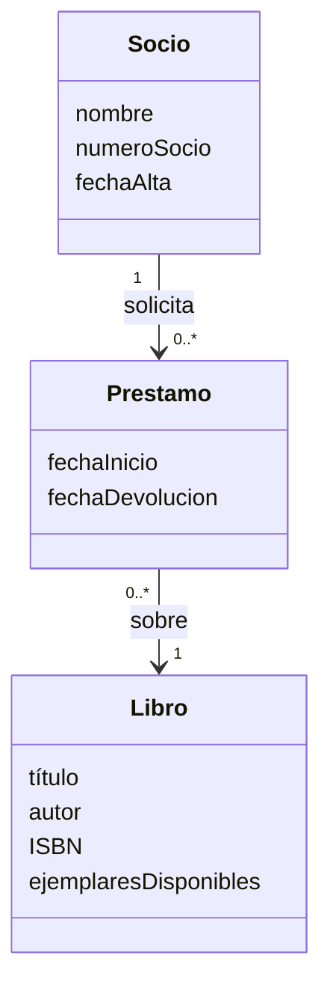
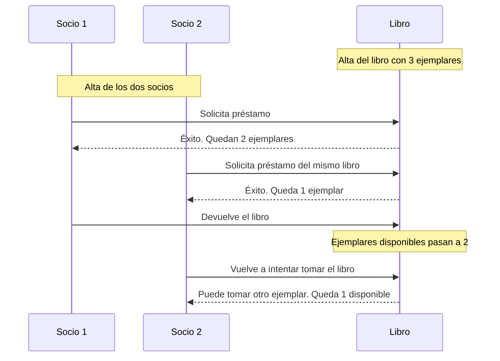

# Ejercicio 1 - Diseño con tarjetas CRC

## Enunciado

Diseñar un sistema de biblioteca que permita registrar libros y socios, gestionar préstamos y registrar devoluciones.

## 1. Tarjetas CRC

### Tarjeta CRC: Libro

| Clase: Libro                                                  |                   |
| ------------------------------------------------------------- | ----------------- |
| **Responsabilidades**                                         | **Colaboradores** |
| Almacenar título, autor e ISBN.                               | —                 |
| Saber cuántos ejemplares quedan disponibles.                  | —                 |
| Facilitar un ejemplar en préstamo cuando haya disponibilidad. | Préstamo          |
| Admitir un ejemplar devuelto y actualizar la disponibilidad.  | Préstamo          |

### Tarjeta CRC: Socio

| Clase: Socio                                       |                   |
| -------------------------------------------------- | ----------------- |
| **Responsabilidades**                              | **Colaboradores** |
| Almacenar nombre, número de socio y fecha de alta. | —                 |
| Pedir un libro prestado.                           | Libro y Préstamo  |
| Realizar la devolución de un libro.                | Préstamo          |

### Tarjeta CRC: Préstamo

| Clase: Préstamo                                    |                   |
| -------------------------------------------------- | ----------------- |
| **Responsabilidades**                              | **Colaboradores** |
| Identificar el libro prestado y el socio asociado. | Libro y Socio     |
| Almacenar cuándo comenzó el préstamo.              | —                 |
| Anotar la devolución del libro.                    | Libro             |

El símbolo — indica que esa responsabilidad no necesita colaborar con otra clase.

## 2. Relación entre las clases

En el diagrama, `Prestamo` representa la clase `Préstamo`.

Un socio puede tener cero o varios préstamos. Cada préstamo está asociado a un único socio y a un único libro. Un libro puede aparecer en diferentes préstamos.

### Comportamiento al prestar un ejemplar

Antes de prestar un ejemplar, se comprueba que la cantidad disponible en Libro sea mayor que cero.

- Si quedan ejemplares, Libro reduce su disponibilidad en una unidad. Se registra un Préstamo que relaciona ese libro con el socio y la operación tiene éxito.
- Si la disponibilidad es cero, se rechaza la solicitud. La cantidad disponible no cambia y no se registra un nuevo préstamo.

Al devolver un ejemplar, Préstamo queda finalizado y Libro incrementa su disponibilidad en una unidad.

## 3. Flujo paso a paso

### Explicación y resumen de resultados

| Paso | Acción y clases que intervienen                                                                                                                 | Resultado               | Ejemplares disponibles |
| ---- | ----------------------------------------------------------------------------------------------------------------------------------------------- | ----------------------- | ---------------------- |
| 1    | Se crea Libro con sus datos y tres ejemplares. Para este alta no necesita colaboradores.                                                        | Libro registrado.       | 3                      |
| 2    | Se crean dos objetos Socio con sus respectivos datos. No se crean préstamos ni cambia la disponibilidad.                                        | Dos socios registrados. | 3                      |
| 3    | El primer Socio solicita un ejemplar. Libro comprueba que quedan unidades y descuenta una. Préstamo relaciona al socio con el libro.            | Préstamo concedido.     | 2                      |
| 4    | El segundo Socio solicita el mismo título. Libro todavía tiene unidades, descuenta otra y se registra un nuevo Préstamo.                        | Préstamo concedido.     | 1                      |
| 5    | El primer Socio devuelve su ejemplar. Préstamo registra su finalización y Libro recupera una unidad disponible.                                 | Devolución registrada.  | 2                      |
| 6    | El segundo Socio solicita otro ejemplar. Libro comprueba la disponibilidad, descuenta una unidad y se registra otro Préstamo asociado al socio. | Préstamo concedido.     | 1                      |

Los tres préstamos tienen éxito porque hay ejemplares disponibles en cada solicitud. El último también se admite: el enunciado no establece un límite por socio ni prohíbe tener dos ejemplares del mismo título.
