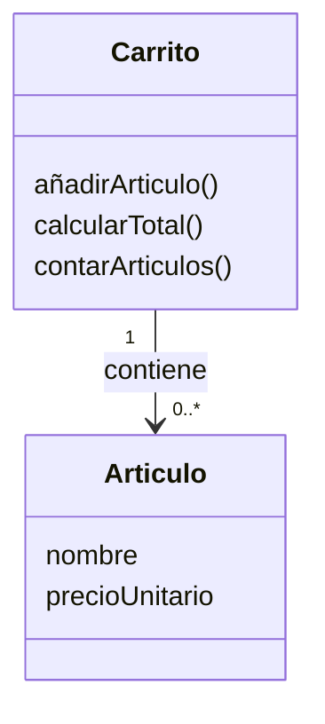
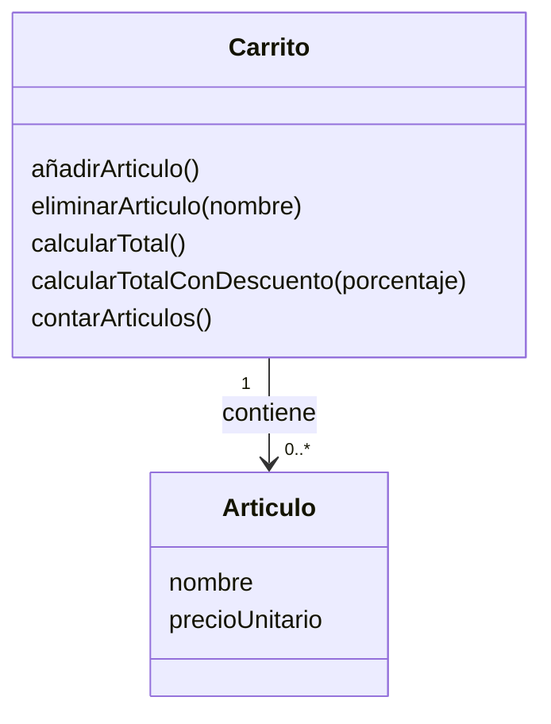
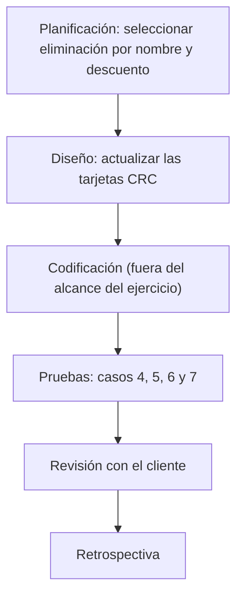

# Ejercicio 2 - Simulación de iteración ágil

## Organización del trabajo

El ejercicio se plantea de forma individual, alternando los roles de driver y navigator.

El driver prepara las tarjetas CRC y los casos de prueba. El navigator revisa que el diseño cubra los requisitos y que los resultados esperados sean coherentes. Estas funciones se alternan durante cada iteración.

## Iteración 1 - Funcionalidades básicas

En esta primera iteración se diseña un carrito que permite añadir artículos, calcular el importe total y consultar cuántos artículos contiene.

### Tarjetas CRC

#### Tarjeta CRC: Artículo

| Clase: Artículo                   |                   |
| --------------------------------- | ----------------- |
| **Responsabilidades**             | **Colaboradores** |
| Almacenar el nombre del artículo. | —                 |
| Almacenar su precio unitario.     | —                 |

#### Tarjeta CRC: Carrito

| Clase: Carrito                                         |                   |
| ------------------------------------------------------ | ----------------- |
| **Responsabilidades**                                  | **Colaboradores** |
| Incorporar un artículo al carrito.                     | Artículo          |
| Obtener el total sumando los precios de los artículos. | Artículo          |
| Informar del número de artículos que contiene.         | Artículo          |

### Diagrama de clases

En el esquema, `Articulo` representa la clase `Artículo`. Un carrito puede contener cero o varios artículos.

### Casos de prueba previstos

Cada caso parte de sus propias condiciones iniciales.

**Caso 1. Carrito vacío.**

Al crear un carrito sin artículos, el cálculo de su total debe devolver 0 €.

**Caso 2. Suma de dos artículos.**

Se añaden un teclado de 10 € y un ratón de 15 €. Al consultar el total, el resultado esperado es 25 €, correspondiente a la suma de ambos precios.

**Caso 3. Número de artículos.**

Después de añadir dos artículos a un carrito inicialmente vacío, la consulta de su cantidad debe indicar que contiene 2 artículos.

## Iteración 2 - Tras la revisión con el cliente

Se simula una revisión con el cliente en la que se solicitan dos nuevas funcionalidades:

- Eliminar un artículo buscando su nombre.
- Calcular el total del carrito con un descuento porcentual aplicado al conjunto.

Se conservan las funcionalidades de la primera iteración.

### Tarjetas CRC actualizadas

La tarjeta de Artículo mantiene sus responsabilidades: almacenar el nombre y el precio unitario.

La tarjeta de Carrito incorpora las dos nuevas responsabilidades:

| Clase: Carrito (actualizada)                                    |                   |
| --------------------------------------------------------------- | ----------------- |
| **Responsabilidades**                                           | **Colaboradores** |
| Incorporar un artículo al carrito.                              | Artículo          |
| Retirar un artículo identificado por su nombre.                 | Artículo          |
| Obtener el total sumando los precios de los artículos.          | Artículo          |
| Obtener el total aplicando un descuento porcentual al conjunto. | Artículo          |
| Informar del número de artículos que contiene.                  | Artículo          |

### Diagrama de clases actualizado

### Nuevos casos de prueba previstos

**Caso 4. Eliminar un artículo existente.**

Se prepara un carrito con un artículo llamado "Teclado", de 10 €, y otro llamado "Ratón", de 15 €. Al eliminar "Teclado" por su nombre, debe permanecer únicamente "Ratón". El total esperado es 15 € y la cantidad de artículos debe ser 1.

**Caso 5. Intentar eliminar un artículo inexistente.**

Se prepara un carrito con "Teclado", de 10 €, y "Ratón", de 15 €. Al solicitar la eliminación de "Monitor", que no está incluido, el carrito debe conservar ambos artículos. El total debe seguir siendo 25 € y la cantidad debe mantenerse en 2.

**Caso 6. Aplicar un descuento porcentual.**

En un carrito cuyo total es 100 €, se solicita calcular el importe con un descuento del 10 %. El descuento equivale a 10 €, por lo que el resultado esperado es 90 €. El porcentaje se aplica al total conjunto del carrito.

**Caso 7. Aplicar un descuento del 0 %.**

En un carrito cuyo total es 100 €, se solicita calcular el importe con un descuento del 0 %. El resultado esperado es 100 €, ya que ese porcentaje no reduce el importe.

Antes de dar por terminada la segunda iteración, también deben seguir cumpliéndose los casos 1, 2 y 3, correspondientes a las funcionalidades iniciales.

### Flujo de la iteración

El flujo representa las fases del proceso. En este ejercicio se documentan el diseño y los casos de prueba previstos; la codificación queda fuera de su alcance.
