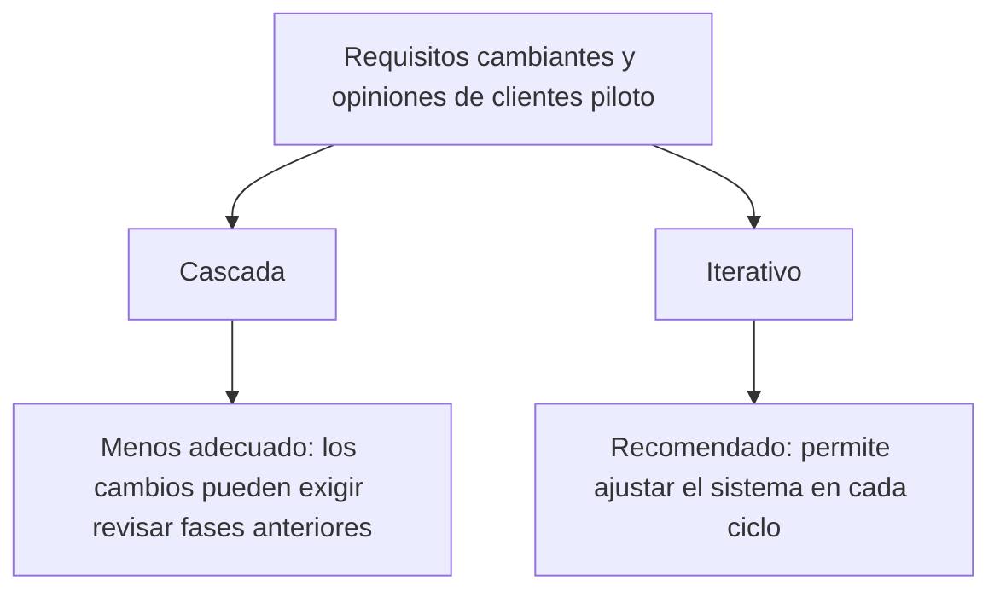
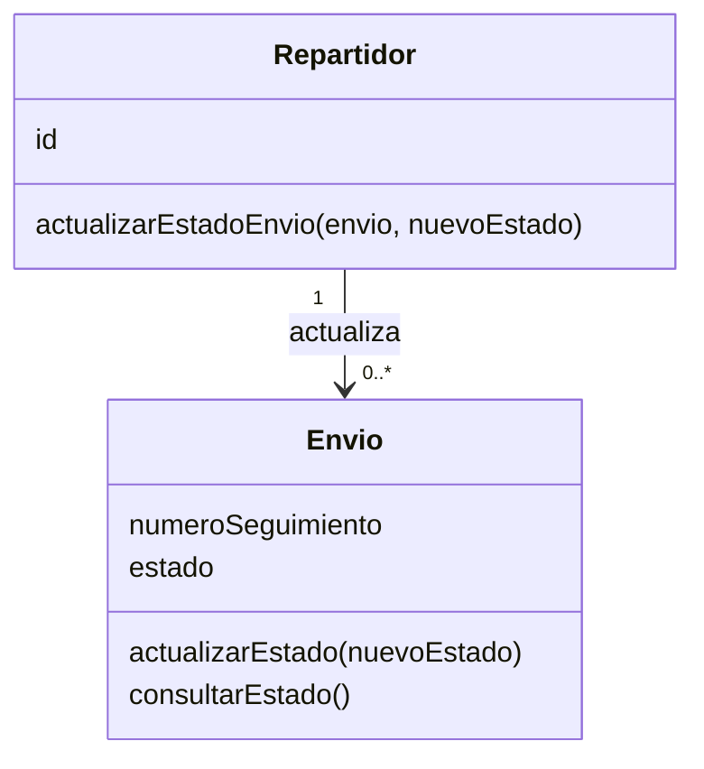
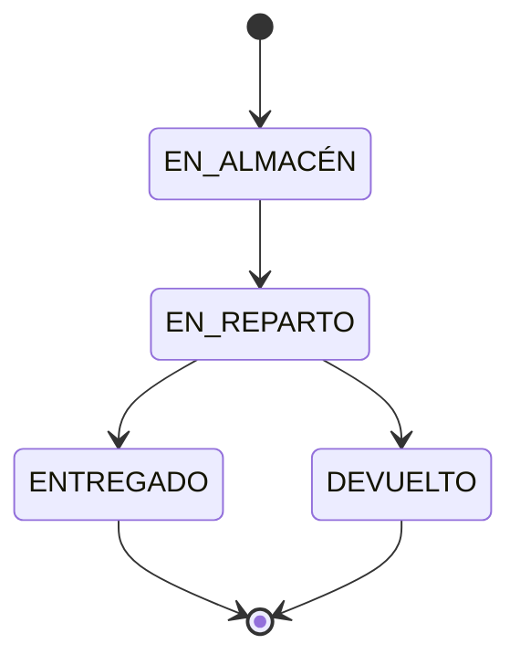

# Ejercicio 3 - Ciclo de vida en la práctica

## Contexto

Una empresa de logística necesita gestionar sus envíos. Los clientes consultarán su estado mediante el número de seguimiento y los repartidores podrán actualizarlo desde el móvil.

Los requisitos irán cambiando a partir de las opiniones de los clientes piloto.

## 1. Modelo de ciclo de vida recomendado

Recomiendo un modelo iterativo porque el enunciado indica que los requisitos cambiarán durante el desarrollo.

Este modelo permite construir versiones sucesivas del sistema, revisar cada una con los clientes piloto e incorporar sus observaciones en la siguiente iteración.

Por ejemplo, una primera versión podría permitir consultar el estado mediante el número de seguimiento. En otra iteración se incorporaría la actualización desde el móvil y se revisarían las mejoras solicitadas.

El modelo en cascada resulta menos adecuado para este contexto, porque los cambios tardíos pueden obligar a revisar fases que ya se habían completado.

## 2. Metodología recomendada

Elegiría una metodología ágil porque el proyecto necesita adaptación y colaboración frecuente con los clientes piloto.

El equipo podría revisar las necesidades, ajustar las prioridades y comprobar si las funcionalidades entregadas responden a lo que esperan los usuarios.

Entre las opciones propuestas, el enfoque ágil encaja mejor con esa necesidad de incorporar cambios y validar el producto durante su desarrollo.

## 3. Tarjetas CRC

### Tarjeta CRC: Envío

| Clase: Envío                                          |                   |
| ----------------------------------------------------- | ----------------- |
| **Responsabilidades**                                 | **Colaboradores** |
| Almacenar su número de seguimiento.                   | —                 |
| Mantener su estado actual.                            | —                 |
| Modificar su estado cuando lo solicita un repartidor. | Repartidor        |
| Facilitar su estado para la consulta del cliente.     | —                 |

### Tarjeta CRC: Repartidor

| Clase: Repartidor                                                   |                   |
| ------------------------------------------------------------------- | ----------------- |
| **Responsabilidades**                                               | **Colaboradores** |
| Mantener su identificador y conocer los envíos que tiene asignados. | Envío             |
| Solicitar la actualización del estado de un envío.                  | Envío             |

### Diagrama de clases

En el esquema, `Envio` representa la clase `Envío`. Un repartidor puede actualizar el estado de varios envíos.

## 4. Comportamiento de la operación de actualizar el estado

### Dato que recibe

La operación recibe `nuevoEstado`: el valor que se quiere asignar como estado actual del envío.

### Valores admitidos

Para este diseño se utilizan los cuatro estados propuestos en el enunciado:

- `EN_ALMACÉN`
- `EN_REPARTO`
- `ENTREGADO`
- `DEVUELTO`

### Validación y resultado

Como confirmación, propongo devolver un valor booleano: `true` si la actualización se aplica y `false` si se rechaza.

El comportamiento sería:

1. Comprobar que `nuevoEstado` coincide con uno de los cuatro valores admitidos.
2. Si es válido, sustituir el estado actual por el recibido y devolver `true`.
3. Si es inválido, conservar el estado anterior y devolver `false`.

Por ejemplo, si un envío está en `EN_ALMACÉN` y recibe `EN_REPARTO`, se aplica la actualización y se devuelve `true`.

Si recibe `EN_TRANSITO`, que no pertenece a la lista definida para este ejercicio, conserva su estado anterior y devuelve `false`.

### Diagrama de estados

El diagrama representa un recorrido habitual del envío. La validación descrita para la operación comprueba que el valor recibido pertenezca a los cuatro estados admitidos.
