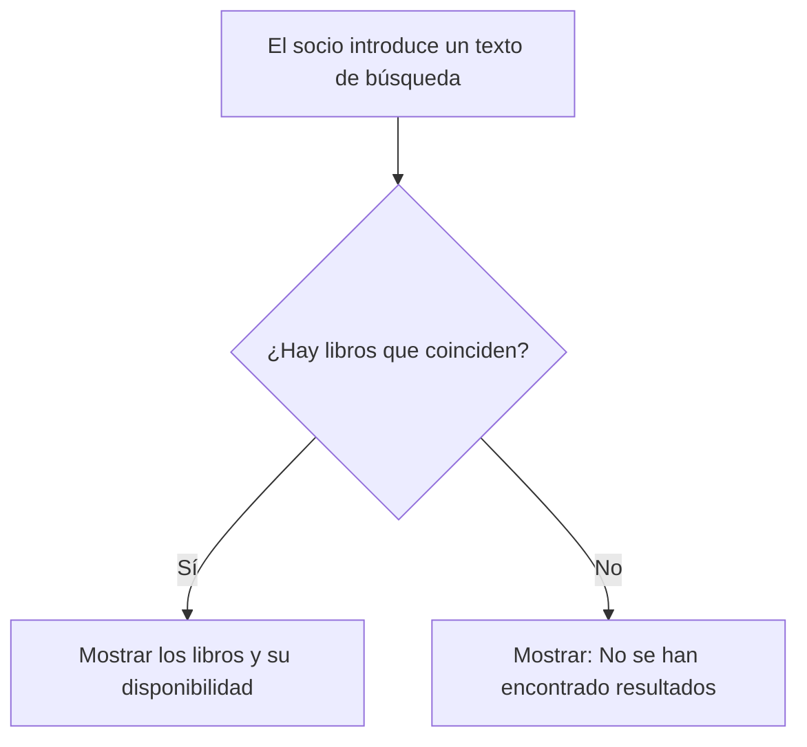

# Ejercicio 4 - Redacción de historias de usuario

## Contexto

Se retoma el sistema de biblioteca del ejercicio 1, que permite registrar libros y socios y gestionar préstamos y devoluciones.

## 1. Historias de usuario

### Historia 1 - Socio

Como socio de la biblioteca, quiero buscar libros por título o autor y consultar su disponibilidad, para saber si quedan ejemplares antes de desplazarme a la biblioteca.

### Historia 2 - Bibliotecario

Como bibliotecario, quiero registrar el préstamo de un libro a un socio, para controlar qué ejemplares están prestados y quién los tiene.

### Historia 3 - Administrador del sistema: propuesta inicial

Como administrador del sistema, quiero consultar informes sobre el uso de la biblioteca, para planificar la compra de nuevos ejemplares.

## 2. Comprobación de los criterios INVEST

INVEST permite comprobar que una historia sea independiente, negociable, valiosa, estimable, pequeña y testeable.

La siguiente tabla analiza las tres propuestas iniciales:

| Criterio            | Historia 1: Socio                                                      | Historia 2: Bibliotecario                                                                       | Historia 3: Administrador                                                          |
| ------------------- | ---------------------------------------------------------------------- | ----------------------------------------------------------------------------------------------- | ---------------------------------------------------------------------------------- |
| I - Independiente   | Sí. La búsqueda puede desarrollarse sobre el catálogo existente.       | Sí. El registro de préstamos puede planificarse por separado.                                   | Sí. Puede utilizar los datos de préstamos ya registrados.                          |
| N - Negociable      | Sí. La presentación del buscador y sus resultados puede acordarse.     | Sí. El flujo de registro y confirmación puede acordarse con el bibliotecario.                   | Sí. El contenido y la presentación de los informes pueden concretarse.             |
| V - Valiosa         | Sí. Ayuda al socio a evitar desplazamientos sin disponibilidad.        | Sí. Permite controlar los préstamos y la disponibilidad de ejemplares.                          | Sí. Aporta información para decidir qué ejemplares comprar.                        |
| E - Estimable       | Sí. Están identificados los datos de búsqueda y el resultado esperado. | Sí. Los datos y las reglas del préstamo están definidos en el ejercicio 1.                      | No todavía. Falta concretar las métricas, el período y el resultado.               |
| S - Pequeña (Small) | Sí. Se limita a una búsqueda básica con información de disponibilidad. | Sí. Se limita al registro de un préstamo de un libro a un socio.                                | No está suficientemente acotada. Los informes podrían abarcar distintas consultas. |
| T - Testeable       | Sí. Se pueden comprobar búsquedas con y sin coincidencias.             | Sí. Se puede comprobar el registro con disponibilidad y el rechazo cuando no quedan ejemplares. | No todavía. El resultado esperado es demasiado impreciso.                          |

### Reformulación de la historia 3

La propuesta inicial del administrador necesita un alcance más concreto.

**Versión definitiva:**

Como administrador del sistema, quiero consultar un listado de libros ordenado de mayor a menor por el número de préstamos iniciados en los últimos 30 días, mostrando ese número para cada libro, para identificar los títulos con mayor demanda y valorar la compra de más ejemplares.

El período se obtiene a partir de la fecha de inicio de cada préstamo, dato contemplado en nuestro diseño de la biblioteca.

### Comprobación de la historia 3 reformulada

| Criterio      | Comprobación                                                                            |
| ------------- | --------------------------------------------------------------------------------------- |
| Independiente | Puede desarrollarse utilizando los registros de préstamos existentes.                   |
| Negociable    | La presentación del listado puede acordarse con el administrador.                       |
| Valiosa       | Permite identificar los títulos más solicitados y apoyar las decisiones de compra.      |
| Estimable     | Están definidos el período, el recuento y el resultado que se mostrará.                 |
| Pequeña       | Se limita a una consulta y un listado ordenado.                                         |
| Testeable     | Se pueden verificar los recuentos y el orden utilizando préstamos con fechas conocidas. |

## 3. Criterios de aceptación de la historia 1

La historia seleccionada es la búsqueda de libros por parte del socio.

### Criterio 1 - Búsqueda con coincidencias

- **Dado** que el catálogo contiene el libro "El Quijote", con 3 ejemplares disponibles.
- **Cuando** el socio busca el texto "quijote", sin distinguir entre mayúsculas y minúsculas.
- **Entonces** el sistema muestra ese libro junto con su disponibilidad de 3 ejemplares.

### Criterio 2 - Búsqueda sin coincidencias

- **Dado** que ningún título ni autor del catálogo coincide con el texto introducido.
- **Cuando** el socio realiza la búsqueda.
- **Entonces** el sistema muestra el mensaje "No se han encontrado resultados".

### Criterio 3 - Campo de búsqueda vacío

- **Dado** que el campo de búsqueda está vacío.
- **Cuando** el socio pulsa el botón "Buscar".
- **Entonces** el sistema solicita que introduzca un texto y no realiza la búsqueda.

### Diagrama de búsqueda

El diagrama resume el flujo cuando el socio introduce un texto de búsqueda.

