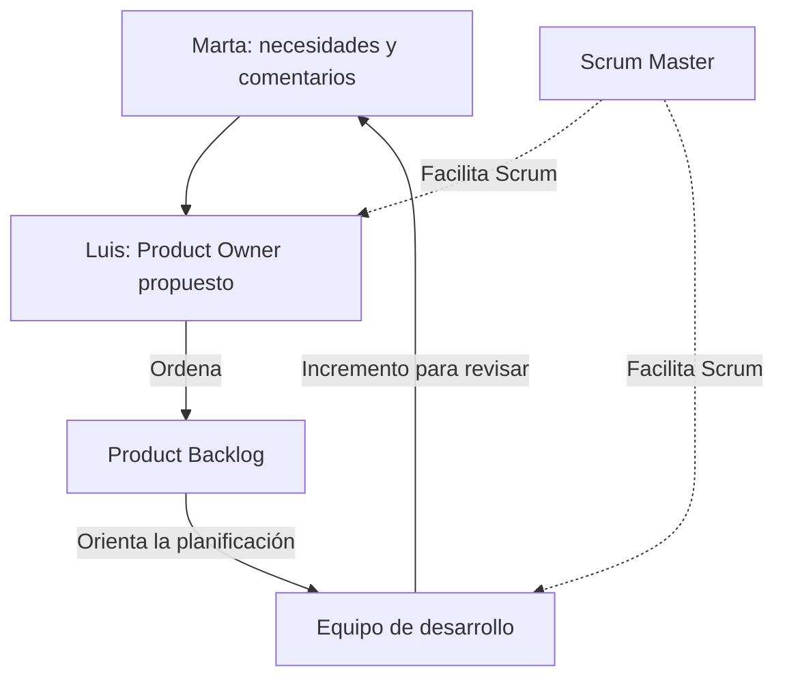
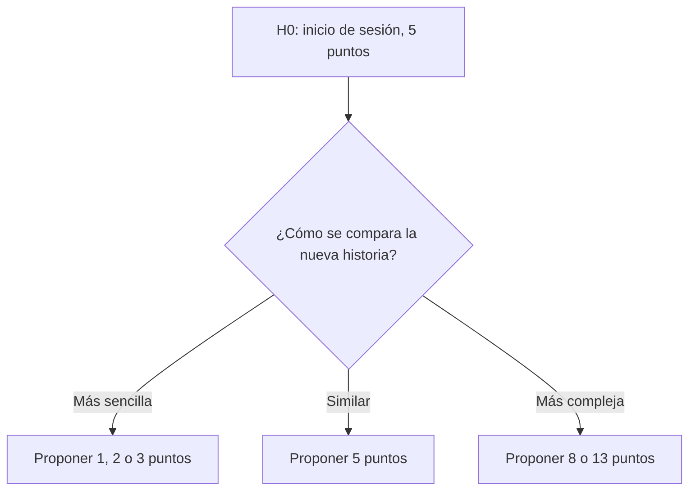

# Ejercicio 5 - Product Backlog con Scrum

## Contexto

Tech4Learning está desarrollando EduPro, una plataforma educativa para profesores y estudiantes.

A partir de las necesidades de Marta y Luis, se proponen los roles, las historias de usuario, sus criterios de aceptación, las estimaciones y el Product Backlog priorizado.

## 1. Roles

| Rol              | Propuesta                                                          | Justificación                                                                                             |
| ---------------- | ------------------------------------------------------------------ | --------------------------------------------------------------------------------------------------------- |
| Product Owner    | Luis, director del centro.                                         | Podría representar las necesidades del centro, decidir qué aporta más valor y ordenar el Product Backlog. |
| Scrum Master     | Una persona de Tech4Learning, sin nombre indicado en el enunciado. | Facilitaría el uso de Scrum y ayudaría al equipo a resolver impedimentos.                                 |
| Development Team | El equipo de desarrollo de Tech4Learning.                          | Diseñaría, construiría y comprobaría las funcionalidades de EduPro.                                       |

Marta participaría como parte interesada o stakeholder: aportaría necesidades desde la perspectiva del profesorado y ayudaría a revisar la utilidad de las funcionalidades.

La asignación de Luis como Product Owner es una propuesta para este ejercicio.

### Relación entre los participantes

## 2. Historias de usuario

### H1 - Publicar material didáctico

Como profesor, quiero publicar archivos PDF, vídeos y enlaces en mi asignatura, para facilitar a mis alumnos los recursos que necesitan para estudiar.

### H2 - Acceder desde distintos dispositivos

Como alumno, quiero consultar el material desde un ordenador, una tableta o un móvil, para estudiar desde el dispositivo que tenga disponible.

### H3 - Organizar el material

Como profesor, quiero agrupar el material por temas o semanas, para que mis alumnos encuentren el contenido correspondiente a cada parte del curso.

### H4 - Crear y programar exámenes online

Como profesor, quiero crear y programar exámenes online con preguntas de opción múltiple y abiertas, para evaluar a mis alumnos mediante la plataforma.

### H5 - Corregir automáticamente las preguntas de opción múltiple

Como profesor, quiero que EduPro corrija automáticamente las respuestas de opción múltiple, para reducir el trabajo de corrección.

### H6 - Recibir avisos de nuevas actividades

Como alumno, quiero recibir una notificación cuando se publique una nueva actividad en mi asignatura, para conocer las novedades y acceder a ellas.

Para esta propuesta, los avisos se mostrarán dentro de EduPro.

## 3. Criterios de aceptación

### H1 - Publicar material didáctico

**CA1 - Archivo PDF**

- **Dado** un profesor situado en su asignatura y un archivo PDF.
- **Cuando** sube y publica el archivo.
- **Entonces** el PDF queda asociado a esa asignatura y disponible para sus alumnos.

**CA2 - Vídeo**

- **Dado** un profesor situado en su asignatura y un archivo de vídeo admitido por la plataforma.
- **Cuando** sube y publica el vídeo.
- **Entonces** aparece entre los materiales de la asignatura y puede reproducirse.

**CA3 - Enlace**

- **Dado** un profesor que introduce la dirección de un recurso externo.
- **Cuando** guarda y publica el enlace.
- **Entonces** el recurso aparece entre los materiales y el enlace permite abrir su dirección de destino.

### H2 - Acceder desde distintos dispositivos

**CA1 - Ordenador**

- **Dado** un alumno que accede desde un ordenador y tiene materiales publicados en su asignatura.
- **Cuando** abre el apartado de materiales.
- **Entonces** puede consultar el listado y acceder a los PDF, vídeos y enlaces disponibles.

**CA2 - Móvil o tableta**

- **Dado** un alumno que accede desde un móvil o una tableta.
- **Cuando** abre el mismo apartado.
- **Entonces** el contenido se adapta al tamaño de pantalla y mantiene disponibles los controles para consultar los materiales.

### H3 - Organizar el material

**CA1 - Agrupación por tema**

- **Dado** un profesor que dispone del grupo "Tema 3" y de un material publicado.
- **Cuando** asigna ese material al tema.
- **Entonces** el material aparece agrupado bajo "Tema 3" en el listado de la asignatura.

**CA2 - Agrupación por semana**

- **Dado** un profesor que dispone del grupo "Semana 2" y de un material publicado.
- **Cuando** asigna ese material a la semana.
- **Entonces** los alumnos pueden localizarlo dentro de "Semana 2".

### H4 - Crear y programar exámenes online

**CA1 - Pregunta de opción múltiple**

- **Dado** un profesor que está preparando un examen.
- **Cuando** añade una pregunta de opción múltiple con sus opciones, la respuesta correcta y su puntuación.
- **Entonces** la pregunta queda guardada con esos datos para utilizarla en el examen y en su corrección.

**CA2 - Pregunta abierta**

- **Dado** un profesor que está preparando un examen.
- **Cuando** añade una pregunta abierta.
- **Entonces** la pregunta queda guardada para que el alumno pueda responder mediante texto libre.

**CA3 - Programación**

- **Dado** un examen con preguntas y una fecha de publicación configurada.
- **Cuando** el profesor confirma su programación.
- **Entonces** el examen queda disponible para los alumnos a partir de la fecha indicada.

**CA4 - Entrega de respuestas**

- **Dado** un alumno que accede a un examen disponible con preguntas de ambos tipos.
- **Cuando** responde y confirma la entrega.
- **Entonces** sus respuestas quedan registradas y asociadas al alumno y al examen para su corrección.

### H5 - Corrección automática

**CA1 - Cálculo de la puntuación**

- **Dado** un examen con dos preguntas de opción múltiple de un punto cada una, ambas contestadas correctamente.
- **Cuando** se procesa la entrega.
- **Entonces** la corrección automática asigna dos puntos sobre dos a esa parte del examen.

**CA2 - Examen con preguntas de ambos tipos**

- **Dado** un examen entregado que combina preguntas de opción múltiple y abiertas.
- **Cuando** se realiza la corrección automática.
- **Entonces** se puntúan las preguntas de opción múltiple y las respuestas abiertas quedan pendientes de revisión por el profesor.

### H6 - Notificaciones

**CA1 - Publicación de una actividad**

- **Dado** que una asignatura tiene alumnos matriculados.
- **Cuando** el profesor publica una nueva actividad.
- **Entonces** esos alumnos reciben en EduPro una notificación que identifica la actividad.

**CA2 - Acceso desde el aviso**

- **Dado** un alumno que ha recibido una notificación.
- **Cuando** abre el aviso.
- **Entonces** accede a la actividad publicada a la que corresponde.

## 4. Estimación con Planning Poker

### Historia de referencia

H0: iniciar sesión con correo electrónico y contraseña.

**Estimación proporcionada por el enunciado: 5 puntos.**

El enunciado confirma su estimación, pero no indica si está implementada.

### Procedimiento de estimación

Para esta simulación se utilizan cartas de 1, 2, 3, 5, 8 y 13 puntos.

Cada historia se compara con H0 considerando su complejidad, las funciones que combina y la incertidumbre que presenta. Los puntos expresan una estimación relativa, no una cantidad de horas.

En una sesión de Planning Poker, los integrantes del equipo elegirían sus cartas individualmente y las mostrarían al mismo tiempo. Las diferencias se discutirían antes de repetir la ronda.

La siguiente tabla recoge propuestas razonadas para este ejercicio; no representa una votación real del equipo.

### Estimaciones propuestas

| Historia                                 | Puntos | Comparación con H0: inicio de sesión, 5 puntos                                                                                              |
| ---------------------------------------- | ------ | ------------------------------------------------------------------------------------------------------------------------------------------- |
| H1 - Publicar material                   | 8      | Supera la referencia porque combina archivos de distintos tipos, almacenamiento, reproducción de vídeo y enlaces externos.                  |
| H2 - Acceso desde distintos dispositivos | 5      | Se propone una complejidad comparable: requiere adaptar y comprobar la consulta de materiales en distintos tamaños de pantalla.             |
| H3 - Organización por temas o semanas    | 3      | Resulta más acotada que H0: relaciona materiales existentes con grupos y permite mostrarlos organizados.                                    |
| H4 - Crear y programar exámenes          | 13     | Es bastante más compleja: combina dos tipos de pregunta, configuración, publicación programada y registro de respuestas.                    |
| H5 - Corrección automática               | 8      | Supera los 5 puntos porque requiere comparar respuestas, calcular puntuaciones y distinguir la parte automática de la revisión manual.      |
| H6 - Notificaciones                      | 5      | Se propone una complejidad comparable: detectar publicaciones, generar los avisos para sus destinatarios y permitir acceder a la actividad. |

### Comparación con la referencia

## 5. Product Backlog priorizado

El criterio combina valor para profesores y alumnos y dependencias entre funcionalidades.

Primero se busca que puedan publicarse y consultarse materiales. Después se prioriza la evaluación online, que Luis considera fundamental. La organización del contenido y los avisos completan la propuesta.

| Orden | Historia                                  | Puntos | Justificación                                                                                        |
| ----- | ----------------------------------------- | ------ | ---------------------------------------------------------------------------------------------------- |
| 1     | H1 - Publicar material didáctico          | 8      | Proporciona los recursos que los alumnos necesitan consultar y sirve de base para H2 y H3.           |
| 2     | H2 - Acceder desde distintos dispositivos | 5      | Hace utilizable el material publicado para los alumnos desde sus distintos dispositivos.             |
| 3     | H4 - Crear y programar exámenes online    | 13     | Aporta la evaluación que Luis considera fundamental y permite recoger las respuestas de los alumnos. |
| 4     | H5 - Corrección automática                | 8      | Depende de los exámenes y las respuestas de H4; reduce directamente el trabajo de corrección.        |
| 5     | H3 - Organizar el material                | 3      | Facilita encontrar los recursos, aunque el material ya puede publicarse y consultarse con H1 y H2.   |
| 6     | H6 - Recibir notificaciones               | 5      | Ayuda a conocer las novedades y se integra con la publicación de actividades.                        |

Este listado prioriza las seis nuevas historias obtenidas de las necesidades de Marta y Luis. H0 se conserva como referencia de estimación.

El orden del Product Backlog no determina por sí solo qué historias entrarán en el próximo Sprint: esa selección requiere considerar el objetivo y la capacidad del equipo.
